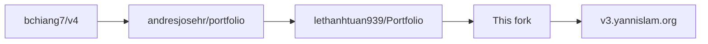

> **Fork of [lethanhtuan939/Portfolio](https://github.com/lethanhtuan939/Portfolio).** The Angular portfolio my site v3 was forked from, kept as a reference for that lineage. The upstream README follows unchanged.

## Architecture

## Related repos

| Repo | Relationship |
|---|---|
| [lethanhtuan939/Portfolio](https://github.com/lethanhtuan939/Portfolio) | Upstream project |
| [v3.yannislam.org](https://github.com/AardeYamz/v3.yannislam.org) | Descendant: the site this lineage became |

---

# Portfolio - Thanh Tuan Le

